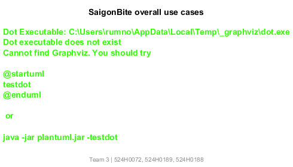
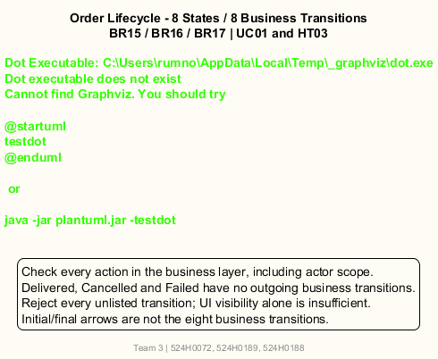
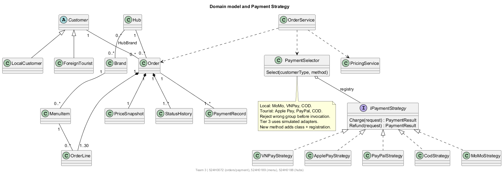
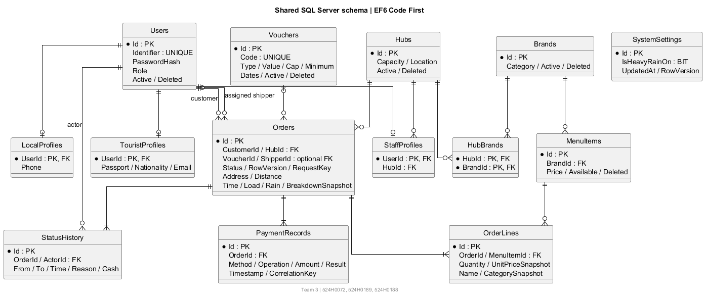
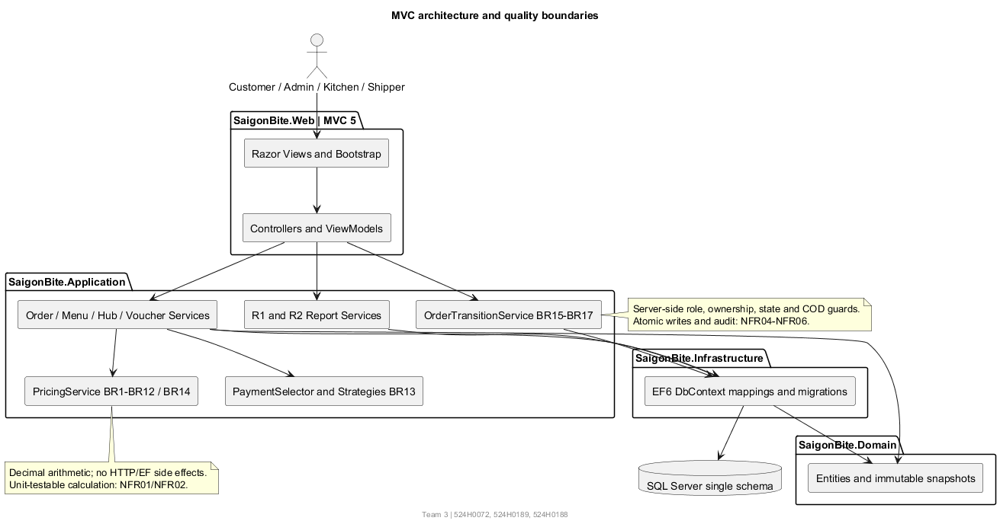

# Part 2 Software Design Architecture and UI UX

Group 3 • SaigonBite • Sem01_2627 • Design baseline 30 October 2026.

UC01 follow-up, 10 November 2026: [daily work plan and Vietnamese specification, 10–17 November](uc01/README.md). Day 1 reviews requirements/specification only; later UML/Figma/report work remains pending. This supplements the shared baseline and does not claim a revised course deadline or instructor approval.

This baseline translates the agreed Part 1 requirements into a design for Tier 3. It includes all three main CRUD use cases and the shared pricing/payment/lifecycle/report features. It is ready for team review; instructor approval, a completed Figma prototype and implementation results are not claimed.

| Main UC | Author responsible for review and development |
|---|---|
| UC01 Place and Manage Orders | Nguyễn Hải Triều — 524H0072 |
| UC02 Manage Menu and Brands | Dương Phạm Thái — 524H0189 |
| UC03 Manage Hubs and Capacity | Lê Quang Tấn — 524H0188 |

The named student is the designated owner. The initial text and diagram sources were AI-assisted and require the owner’s review; attribution does not claim the student independently authored or approved this draft.

## 2.1 Overall Use Case Diagram

Source: [overall-use-case.puml](diagrams/overall-use-case.puml). Team model: 524H0072, 524H0189, 524H0188.

`Customer` is abstract; `Local Customer` and `Foreign Tourist` specialize it. Other actors are Kitchen Staff, Shipper and System Admin. UC01 combines create, view/track, edit and cancel. UC02 manages brands/menu; UC03 manages hubs/capacity. HT01 accounts, HT02 vouchers, HT03 kitchen/delivery and HT04 reports remain required supporting functions. Operational actor roles are separate from student development ownership.

## 2.2 Use Case Specifications

See [use-cases.md](use-cases.md) for all three main use cases, each including CRUD, preconditions, main/alternate/exception flows, postconditions and FR/BR references.

## 2.3 Behavioral Diagrams

- [UC01 activity](diagrams/uc01-order-activity.puml) — designated owner 524H0072.
- [UC02 activity](diagrams/uc02-menu-activity.puml) — designated owner 524H0189.
- [UC03 activity](diagrams/uc03-hub-activity.puml) — designated owner 524H0188.
- [Order lifecycle](diagrams/order-state.puml) — team model. The eight states and eight permitted transitions match BR15 exactly. Actor/ownership/conditions are guards checked in the business layer.

Placed is the state after successful placement; a cart is not an additional persisted Order lifecycle state. Delivered, Cancelled and Failed are terminal. No Preparing → Cancelled or Ready → Delivered shortcut is permitted.

## 2.4 Structural and CRC Design

### 2.4.1 CRC Cards

Detailed responsibility/collaboration cards are in [crc-cards.md](crc-cards.md). The table below is the compact report summary.

| Class | Responsibilities | Collaborators | Design owner |
|---|---|---|---|
| OrderService | Orchestrate place/edit/cancel, ownership and atomic persistence | PricingService, PaymentSelector, Order, DbContext | 524H0072 |
| PricingService | Calculate BR1–BR12/BR14 from immutable input; return breakdown | PricingContext, VoucherEvaluator | 524H0072 |
| PaymentSelector | Reject actor/method mismatch; select a registered strategy | IPaymentStrategy, Customer | 524H0072 |
| IPaymentStrategy and five strategies | Simulate charge/refund result using a stable interface | PaymentResult, PaymentRecord | 524H0072 |
| OrderTransitionService | Apply exact BR15 guards; append audit and timestamps | Order, StatusHistory, ActorContext | Team; UC01/HT03 integration |
| MenuService | Brand/menu CRUD, availability, hub-brand validation and soft deletion | Brand, MenuItem, HubBrand, DbContext | 524H0189 |
| HubService | Hub CRUD, positive integer capacity, hub-brand membership and rain setting | Hub, HubBrand, HubLoadService | 524H0188 |
| HubLoadService | Derive active load; reuse for pricing, acceptance and R2 | Order query, Hub | 524H0188 |
| VoucherService | Voucher CRUD and validation; retain referenced history | Voucher, VoucherEvaluator | Support assignment proposed |
| RevenueReportService | Aggregate R1 by date/category/method and reconcile totals | Delivered orders, price snapshots | Support: 524H0072 proposed |
| HubReportService | Compute R2 counts/time/current load/discount count | StatusHistory, order snapshots | Support: 524H0188 proposed |

### 2.4.2 UML Class Diagram and ERD

See [domain-and-payment.puml](diagrams/domain-and-payment.puml) and [database-erd.puml](diagrams/database-erd.puml). Payment Strategy is a class model, not merely a database table. Customer generalization is explicitly present. The relational design uses shared Users and customer-specific profiles in one SQL Server schema.

### 2.4.3 Database Design Notes

See [architecture.md](architecture.md) for entity keys, decimal/time representation, deletion policy, transaction boundaries and concurrency decisions. Load is derived, not a mutable counter stored on Hub. Snapshots protect past prices, hub load and rain conditions. Existing order lines and financial records are not hard-deleted when referenced catalog entities are deactivated.

## 2.5 Architecture and Quality Design

Target: ASP.NET MVC 5 / .NET Framework 4.8, EF6 Code First, SQL Server, Bootstrap. [Architecture diagram](diagrams/architecture.puml).

| Principle | Design application | Quality link |
|---|---|---|
| Separation of concerns | Views display; controllers bind/authorize; services enforce business rules; EF maps persistence | NFR02, NFR04 |
| High cohesion and low coupling | Pricing has no HTTP/EF/payment-side effects; each service owns a clear business responsibility | NFR01, NFR02 |
| Single Responsibility | Pricing, payment selection, transitions and reports have separate classes | NFR02 |
| Open/Closed and Dependency Inversion | OrderService depends on IPaymentStrategy via selection; new method adds a class/registration without editing old strategies | NFR02 |
| Encapsulation | State changes go through the transition service; snapshots are immutable after placement | NFR05, NFR06 |
| Server-side validation | Recheck role, ownership, state and numeric boundaries in services, regardless of UI buttons | NFR04 |

Pricing BR1–BR14 lives in business services because every caller must apply the same rules and tests must run without a browser. Migrations are reviewed in Git and tested against both fresh and existing databases. Full NFR verification remains planned; no execution result is inferred from a diagram.

## 2.6 UI UX Design

See [UI specification and Figma checklist](ui-specification.md). Required frames include registration/login for both customer types, hub/menu selection, price breakdown/payment, order tracking/edit/cancel, menu and hub administration, kitchen board, shipper tasks, and both reports. Include responsive desktop/mobile variants and Vietnamese/English switching.

**Native Figma link: pending creation and publication.** This source package is not a completed Part 2 submission until screenshots, an accessible Figma prototype and reviewed diagrams are inserted into the official Word template and exported to a bookmarked PDF.

## Open decisions carried from Part 1

AMB01: manual Admin shipper assignment at Ready. AMB02: no automatic refund for Failed, subject to instructor confirmation; Cancelled is always fully refunded online. AMB03: existing line unit prices stay fixed, added lines use their current price. AMB04: recognize revenue only for Delivered at delivery time; allocate discounts by food value. AMB05: mock charge/refund edit differences atomically before committing. AMB06: handled means ever Confirmed; prep average only complete samples; granted Quiet Kitchen counts include later cancellation and are labeled. These are proposals, not instructor decisions.

Further design assumptions: capacity > 0; inactive hubs accept no new orders but keep existing work; selected hub remains fixed when editing a Placed order; hub-brand changes cannot invalidate existing orders; rain flag is global as the specification describes one Admin flag. Record instructor corrections in the Feedback Log and propagate them through FR/design/tests.

## Design Review presentation plan

7–10 minutes, all members speak. Triều: customer flow, pricing snapshots, Payment Strategy and cancellation. Thái: brand/menu CRUD, soft-delete and CRC interactions. Tấn: hub capacity/load, ERD and R2. Together: architecture, eight-state lifecycle, Figma walkthrough, unresolved assumptions and rationale. Use actual diagrams/prototype rather than claiming unfinished implementation.
